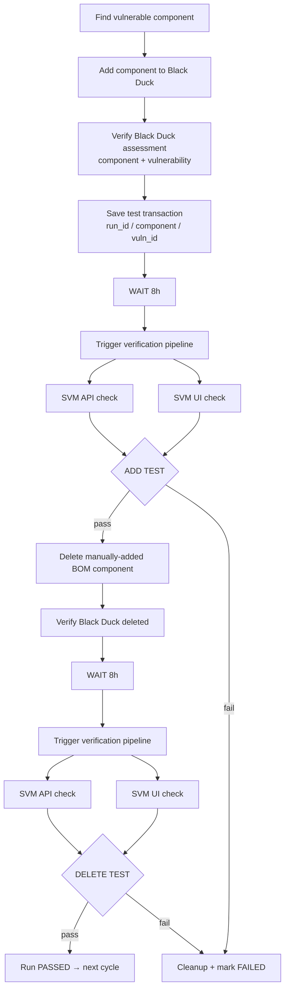

# Architecture

## Goal

Verify the full lifecycle: a component added in Black Duck appears in SVM, and
after it is removed from Black Duck it disappears from SVM. The test is not
just the Black Duck API — it exercises BD → pipeline → SVM (API and UI).

## Flow

## Resumable state machine

The two 8-hour waits are **not** implemented as sleeps. Each cycle is a row in
SQLite (`data/state.db`) with a `phase` and a `due_at` timestamp:

| status | phase | meaning | next action when `due_at` passes |
|---|---|---|---|
| ACTIVE | `ADD_WAIT` | component is in BD, waiting for sync | trigger pipeline, run ADD TEST, delete from BD |
| ACTIVE | `DELETE_WAIT` | component removed from BD, waiting for sync | trigger pipeline, run DELETE TEST |
| PASSED | `DONE` | both tests passed | – |
| FAILED | `DONE` | a test/step failed; component cleaned up | – |

`tick` finds due runs and advances each by one step. Any process can tick, so
it survives restarts and works from cron or CI schedules. `loop` is just
`tick` + start-new-cycle + sleep.

## Modules

| Module | Responsibility |
|---|---|
| `bd_svm/config.py` | Defaults, YAML + `${ENV}` expansion, `.env`, validation |
| `bd_svm/blackduck.py` | Auth, project lookup, component search, add/delete BOM, assessment |
| `bd_svm/svm.py` | `SvmApiCheck`, `SvmUiCheck` (Selenium), record matching, pass/fail evaluation |
| `bd_svm/pipeline.py` | GitLab trigger (with polling), webhook, or local command |
| `bd_svm/store.py` | SQLite run persistence |
| `bd_svm/orchestrator.py` | The flow above |
| `bd_svm/cli.py`, `report.py` | Commands and Markdown report |

## Failure semantics

- **Test failure** (component missing/still present in SVM, pipeline failed, BD
  assessment missing): run → `FAILED`, and a best-effort delete of the test
  component runs so no test data is left in Black Duck. If cleanup fails the
  run records `cleanup_error` and the report flags it for manual removal.
- **Transient error** (SVM/UI unreachable, BD 5xx): the step is retried after
  `test.retry_seconds`, up to `test.max_attempts`, then fails. The pipeline is
  *not* re-triggered on a retry of the same phase.
- **Pass criteria** across API and UI: `svm.require: all` (default) or `any`.
  A check that errored never counts as a pass or a fail — it is retried.
- `tick` exits non-zero if a run failed in that tick, so CI/cron can alert.

## Matching in SVM

A record (API JSON object or UI row) matches when the component name, the
component version (unless `match_version: false`) and the vulnerability id all
appear in the same record. ADD TEST expects a match; DELETE TEST expects none.
