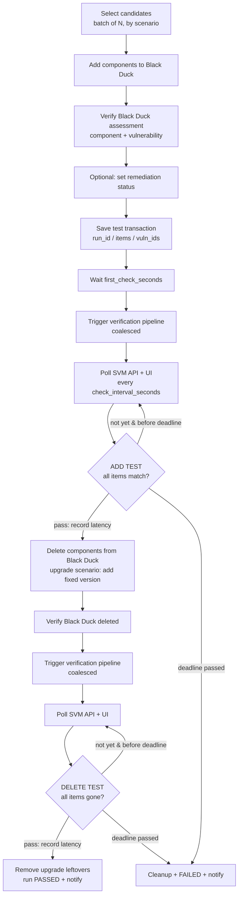

# Architecture

## Goal

Verify the full lifecycle: a component added in Black Duck appears in SVM, and
after it is removed from Black Duck it disappears from SVM. The test is not
just the Black Duck API — it exercises BD → pipeline → SVM (API and UI), and
measures how long the sync takes.

## Flow

`test.mode: fixed` collapses each polling loop to a single check after
`wait_hours` (the original design).

## Resumable state machine

Waits are **not** sleeps. Each run is a row in SQLite (`data/state.db`) with a
`phase` and a `due_at` timestamp:

| status | phase | meaning | when `due_at` passes |
|---|---|---|---|
| ACTIVE | `ADD_WAIT` | items are in BD, waiting for / polling SVM | ensure pipeline triggered, check pending items; all pass → delete in BD → `DELETE_WAIT`; otherwise reschedule (poll) or fail (deadline) |
| ACTIVE | `DELETE_WAIT` | items removed from BD, polling SVM | check pending items; all gone → `PASSED` |
| PASSED / FAILED | `DONE` | finished; BD cleaned up | – |

`tick` advances every due run by one step. Any process can tick, so it
survives restarts and works from cron / CI schedules. `loop` is
`tick` + `maybe_start` + sleep; `drain` ticks until nothing is active.

## Batches, scenarios and overlap

- A run covers `test.batch_size` components (**items**). The pipeline is
  triggered once per phase for the whole batch, and each item is checked and
  timed individually. Items that already passed are not re-checked.
- Each candidate has a **scenario** (see [TESTING.md](TESTING.md)):
  `standard`, `remediation`, `upgrade`, `negative`.
- `test.max_active_runs > 1` overlaps cycles: a new cycle starts while earlier
  ones are still waiting (`start_interval_minutes` spaces them). Total
  throughput rises without more pipeline runs, because of coalescing:

### Pipeline coalescing

Before triggering, a phase checks the last trigger recorded in the `meta`
table. If it **started strictly after** this run's add/delete time, that trigger
necessarily saw the change, so it is reused (`coalesced: true`). A trigger that
started earlier is never reused — it may have read the BOM before the change.
Triggers record their *start* time, not completion.

## Modules

| Module | Responsibility |
|---|---|
| `config.py` | Defaults, YAML + `${ENV}` expansion, `.env`, validation |
| `http.py` | Session with retry/backoff on 429/5xx for idempotent calls |
| `blackduck.py` | Auth, projects/versions, KB search, BOM add/update/delete, remediation, policy, risk, raw |
| `svm.py` | `SvmApiCheck` (field-level), `SvmUiCheck` (Selenium + screenshot), matching, evaluation |
| `pipeline.py` | GitLab trigger (+polling), webhook, command |
| `store.py` | SQLite: runs + meta (trigger coalescing) |
| `orchestrator.py` | The flow above, plus orphan sweep |
| `notify.py` | Slack / Teams / generic webhook |
| `report.py` | Markdown, JUnit XML, JSON, latency stats |
| `cli.py`, `bdcli.py` | Commands (`make` targets wrap these) |
| `mock_server.py` | Fake Black Duck + SVM + pipeline for demos and integration tests |

## Failure semantics

- **Test failure** (item not as expected by the deadline, pipeline failed, BD
  assessment missing, field mismatch): run → `FAILED`; every item's component
  (and any upgrade leftovers) is deleted from Black Duck; a notification is
  sent. If cleanup itself fails, `cleanup_error` is recorded, a
  `cleanup_failed` notification is sent, and `make sweep` can remove leftovers.
- **Transient error** (SVM/UI unreachable, BD 5xx beyond HTTP retries): the
  step is retried after `test.retry_seconds`, up to `test.max_attempts`
  consecutive errors, then fails. A successful check resets the counter. An
  errored check is never counted as pass or fail.
- **Pipeline** is not re-triggered by retries (unless
  `pipeline.retrigger_every_seconds` is set).
- `tick` exits non-zero when a run failed in that tick.

## Matching in SVM

A record (API JSON object or UI row) matches when the component name, version
(unless `match_version: false`) and vulnerability id appear in the same record.
Positive scenarios expect a match *with correct fields* (severity, remediation
status — API check, via `svm.api.fields`); the delete test and `negative`
scenario expect no match.
