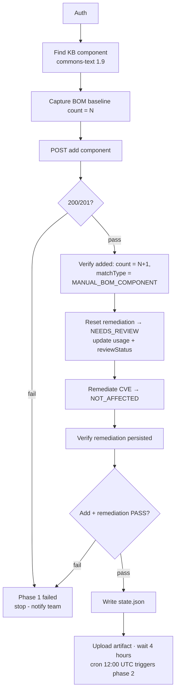
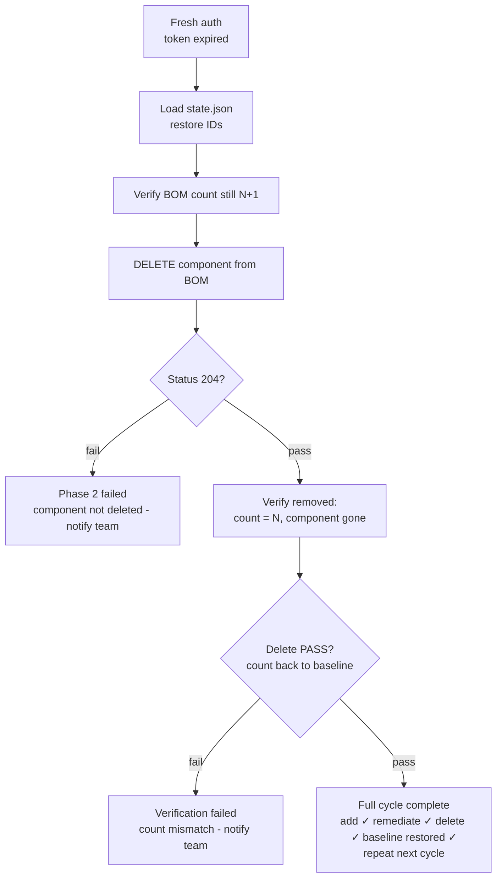

# Design: two-phase Black Duck API automation

> How to run it: [HOWTO.md](HOWTO.md) · settings: [SETTINGS.md](SETTINGS.md) · assumptions: [ASSUMPTIONS.md](ASSUMPTIONS.md)

A scheduled, two-phase API test of the Black Duck BOM lifecycle. Phase 1 adds a
vulnerable component and assesses it; four hours later Phase 2 removes it and
proves the BOM is back to where it started.

## Project structure

```
tests/
  phase1/test_setup.py      12 steps   add → verify → assess → write state.json
  phase2/test_teardown.py    5 steps   load state.json → delete → verify baseline
  test_api_health.py                   smoke test (read-only)
utils/
  auth.py                   bearer token + cache
  api_client.py             GET / POST / PUT / DELETE (+ BOM helpers)
  state.py                  save / load state.json
  reporter.py               HTML report extras
  bd_headers.py             media types
config/
  settings.py               BD_HOST, BD_API_KEY, paths, test data
.github/workflows/
  phase1.yml                cron 08:00 UTC
  phase2.yml                cron 12:00 UTC
.env                        local settings (git-ignored; template: .env.example)
state.json                  generated, git-ignored
conftest.py                 client fixture, abort-on-first-failure, report wiring
devtools/                   mock Black Duck + framework self-tests
```

## Timeline

| | Phase 1 · 08:00 UTC | Wait | Phase 2 · 12:00 UTC |
|---|---|---|---|
| Workflow | `phase1.yml` | 4 hours — `state.json` stored as a GitHub artifact | `phase2.yml` |
| Tests | `test_setup.py` (12) | | `test_teardown.py` (5) |
| Auth | fresh bearer token | token expires | fresh bearer token |

## Phase 1 — `test_setup.py` (12 steps)

| Step | Test | What it does / asserts |
|---|---|---|
| 01 | Auth | fresh bearer token |
| 02 | Find project by name | `GET /api/projects?q=name:…` → exact match → `project_id` |
| 03 | Find project version | `GET …/versions?q=versionName:…` → `version_id` |
| 04 | Find KB component | search KB for `commons-text` `1.9` → `component_id` + `comp_ver_id` |
| 05 | Baseline count, then add | `GET …/components` → `totalCount = N`; component must not already be in the BOM; `POST` add (200/201) |
| 06 | Verify added | count = **N+1**; item present with `matchTypes ∋ MANUAL_BOM_COMPONENT` |
| 07 | Reset remediation | wait for the CVE to appear, `PUT …/remediation` → `NEEDS_REVIEW` |
| 08 | Update usage + reviewStatus | `PUT` the BOM item with `usages` and `reviewStatus` |
| 09 | Verify update persisted | `GET` item → `usages`, `reviewStatus` as written |
| 10 | List all vulnerabilities | `GET …/vulnerable-bom-components`; CVE present, status `NEEDS_REVIEW` |
| 11 | Remediate CVE | `PUT …/remediation` → `NOT_AFFECTED` |
| 12 | Verify remediation + write state.json | status `NOT_AFFECTED` persisted; `state.json` written |



## Phase 2 — `test_teardown.py` (5 steps)

| Step | Test | What it does / asserts |
|---|---|---|
| 01 | Auth | fresh bearer token (the phase 1 token has expired) |
| 02 | Load state.json | show all IDs and phase 1 counts |
| 03 | Verify count still N+1 | the component still exists after 4 hours |
| 04 | Delete component | `DELETE …/components/{component_id}/versions/{comp_ver_id}` → **204** |
| 05 | Verify baseline restored | count = N+1−1 = **N**; component gone from the BOM list |



## State hand-off — `state.json`

Written by phase 1 (step 12), read by phase 2 (step 02), uploaded as the GitHub
artifact `state-json`, **expires in 1 day**. IDs and counts only, no secrets.

```json
{
  "run_id": "local-1728823440",          // GitHub run id in CI, else local-<epoch>
  "project_id": "ab7db74f-…",
  "version_id": "53beb3f8-…",
  "component_id": "f2c3b205-…",
  "comp_ver_id": "71b33227-…",
  "vuln_id": "CVE-2022-42889",
  "bom_count_before": 10,                // baseline N
  "bom_count_after": 11                  // verified N+1
}
```

Count audit trail: phase 1 baseline 10 → after add 11 ✓; phase 2 before delete
11 → after delete 10 ✓; **after delete == baseline (restored)**.

## Failure behaviour

- **Stop at the first failure.** Steps within a phase depend on each other, so
  the remaining steps are *skipped* (not failed) and the job fails →
  `Phase failed: stop — notify team` (webhook if `NOTIFY_WEBHOOK_URL` is set,
  plus GitHub's own failure notification).
- **No test data left behind.** If phase 1 fails *after* the add, its module
  teardown deletes the component again; no `state.json` is written.
- **Phase 2 never deletes blindly.** It only deletes the component recorded in
  `state.json`, and only after confirming the BOM count is still N+1.
- **Count drift.** If someone else changes the BOM between the phases the
  count audit fails (step 03 or 05) rather than guessing — investigate
  manually. Use a dedicated project to avoid this.
- Missing/expired `state.json` fails phase 2 at step 02 with an explanation.

## Reporting

`pytest-html` produces `phase1-report.html` / `phase2-report.html`
(self-contained). `utils/reporter.py` attaches every API call (method, URL,
status, request body, response snippet, timing) and the count-audit notes to the
test that made it. Reports are uploaded as artifacts on every run.
